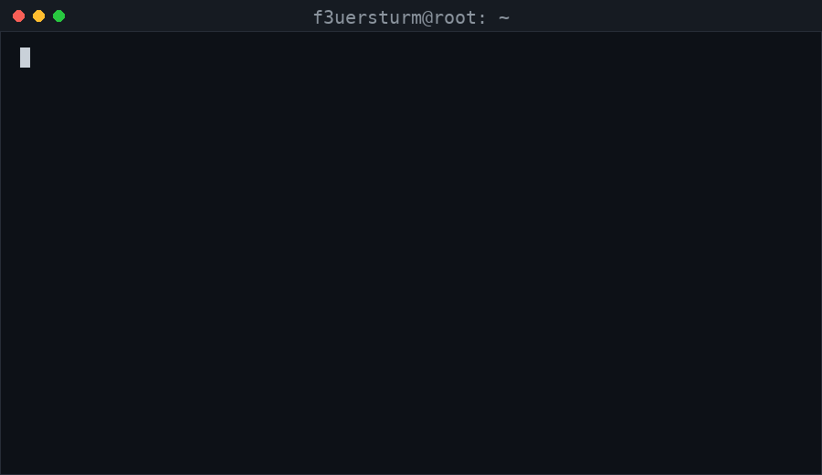

# Antonio R. Lucero (f3uersturm)

Técnico informático y de redes desde 2011; en 2015 di mis primeros pasos en ciberseguridad y hoy me reoriento de lleno hacia lo ofensivo/defensivo. Con formación en desarrollo full-stack (Angular + Spring Boot) por Argentina Programa, y usando IA para prototipar arquitecturas más complejas y seguir aprendiendo Java, Python y Bash.

## En qué estoy trabajando

- Resolviendo máquinas en Hack The Box y documentando la metodología completa de cada una.
- Armando un lab de detección (Wazuh sobre Windows + Kali) para practicar purple teaming: atacar y ver qué detecta el lado defensivo.
- Adaptando y mejorando scripts de automatización para setup y reconocimiento (Bash es un área que estoy fortaleciendo activamente).

## Proyectos

### Write-ups de Hack The Box
Metodología por máquina: reconocimiento, enumeración, explotación, escalada de privilegios, remediación.
*(en construcción)*

### Lab SOC: SIEM con Wazuh + análisis de tráfico con Wireshark
Home lab del BootCamp Analista SOC Nivel 1 (DOJO, 2024): despliegue de Wazuh con agente en un endpoint Windows, y análisis forense de una captura de tráfico que termina en la identificación positiva de un troyano (`neuro.msi`), verificado por firma de archivo y confirmado en VirusTotal (40/66 motores).
- [Write-up completo](./writeups/soc-nivel1-wazuh-wireshark.md)

### Lab de detección: Wazuh + Windows + Kali
Ataques simulados desde Kali contra un host Windows con agente Wazuh, documentando qué se detecta y qué no.
*(en construcción)*

### Scripts de post-instalación para Kali Linux
Suite de 7 scripts para dejar un Kali 2026.2 dual-boot listo (contenedores rootless con Podman/Distrobox, kill switch de VPN (WireGuard), detección de entorno de escritorio). Investigados y adaptados de distintas fuentes, refinados con asistencia de IA.
*(repo próximamente)*

## Formación (Argentina Programa)

### Proyecto Integrador — Angular + Spring Boot
Frontend en Angular y backend en Spring Boot, escritos por mí durante el curso. En proceso de resolver la integración CORS entre ambos.
- [FrontEnd](https://github.com/f3uersturm/FrontEnd)
- [BackEnd](https://github.com/f3uersturm/BackEnd)

### Peluqueria Canina — Java de escritorio
Trabajo práctico en Java (NetBeans/Swing), POO sin frameworks.
- [Repo](https://github.com/f3uersturm/Peluqueria_Canina)

## Otros proyectos (desarrollo asistido por IA)

### Agendia — SaaS de gestión de turnos
Sistema multi-tenant (Spring Boot + Angular + PostgreSQL). Definí los requisitos y las decisiones de seguridad — aislamiento de datos entre clientes a nivel de base de datos, autenticación con JWT por tenant — y usé IA para implementar la arquitectura, como forma de entender en profundidad cómo se resuelven esos problemas en la práctica.
*(repo próximamente)*

## Stack

**Seguridad:** Kali Linux, Nmap, Burp Suite, Metasploit, Wazuh
**Desarrollo:** Angular, Spring Boot, Java · Aprendiendo: Python/Django, Bash
**Infraestructura:** Linux, redes, Podman/Distrobox

## Formación

- BootCamp Analista SOC Nivel 1 (DOJO) — completado, 2024
- HTB Academy — curso Ethical Hacker, en curso (certificado a confirmar)
- Licenciatura en Ciberdefensa — inscripción en curso
- Postulando a la beca de certificación de bug bounty de Hackademy (Ekoparty)

## Contacto

- LinkedIn: https://www.linkedin.com/in/antonio-r-lucero-80b229b4/
- Email: acmluxero@gmail.com
