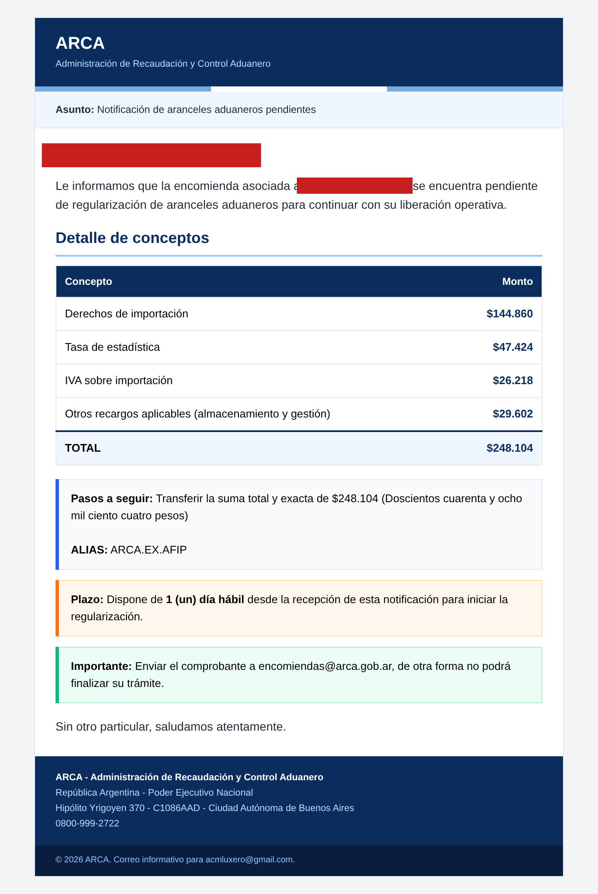
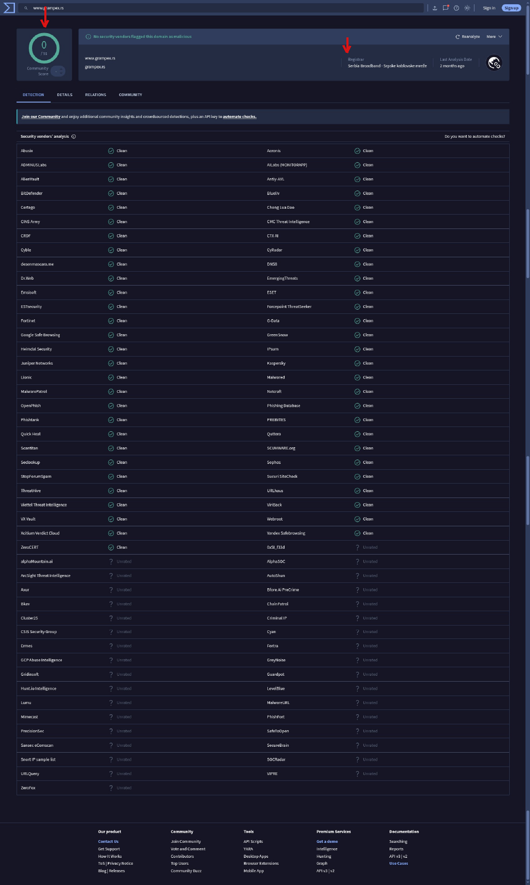
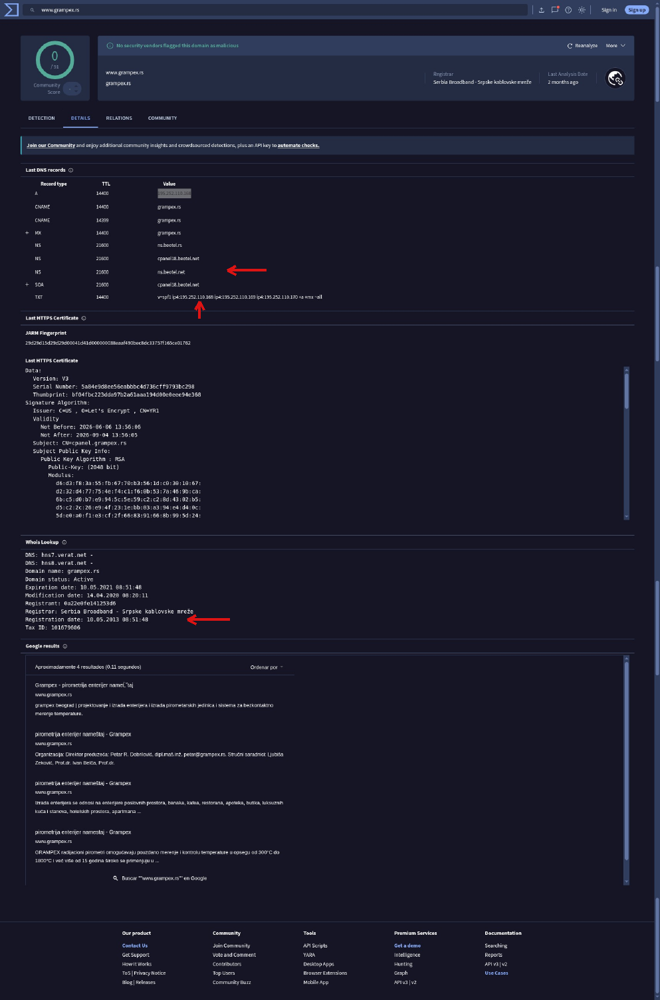
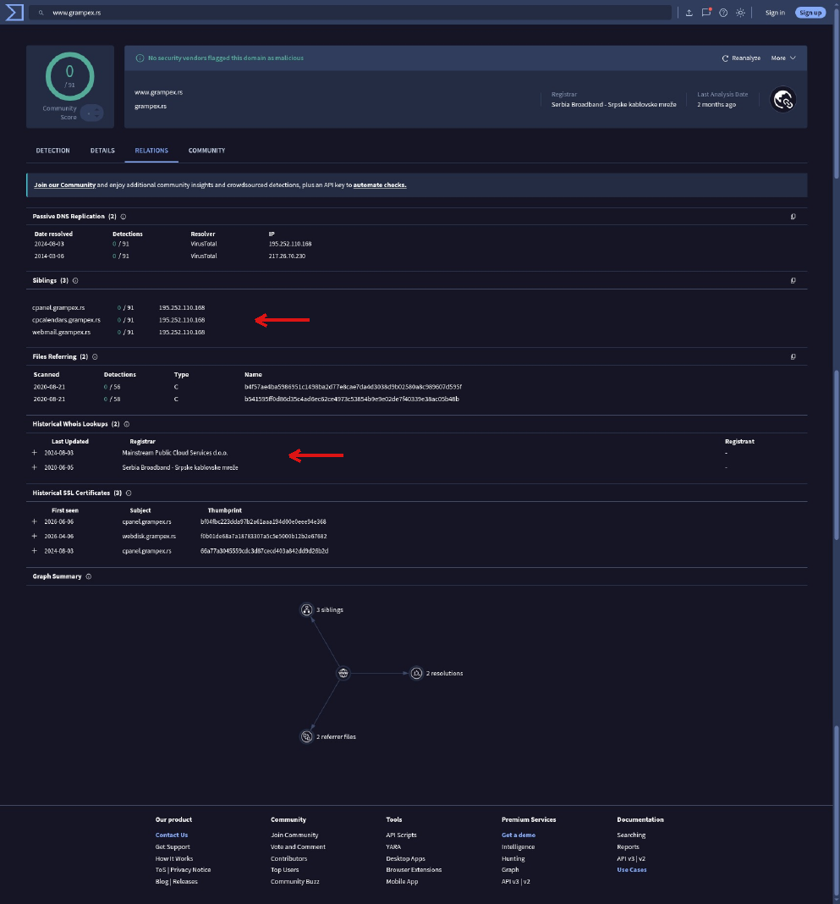
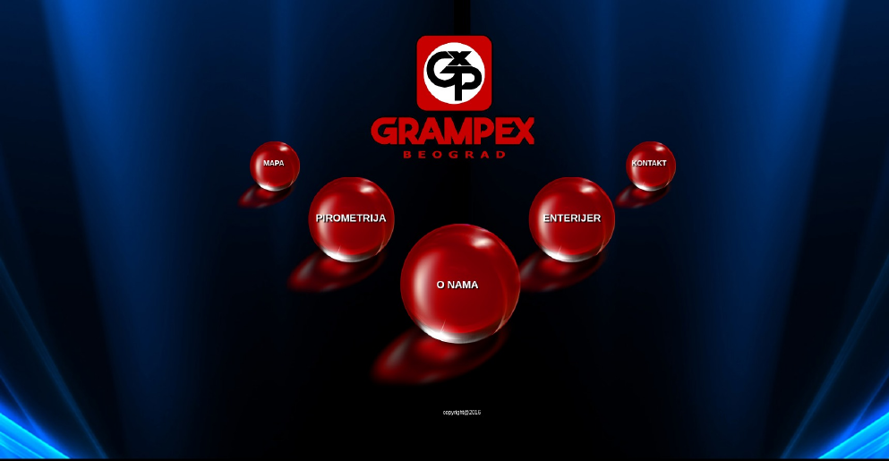
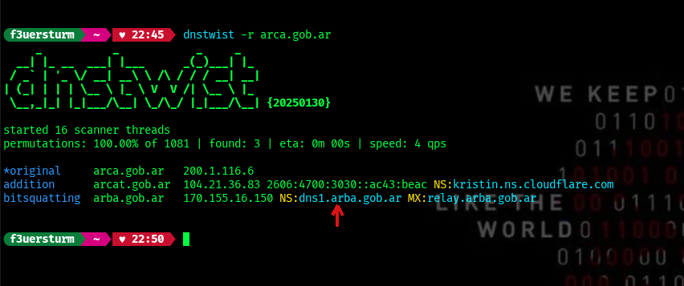
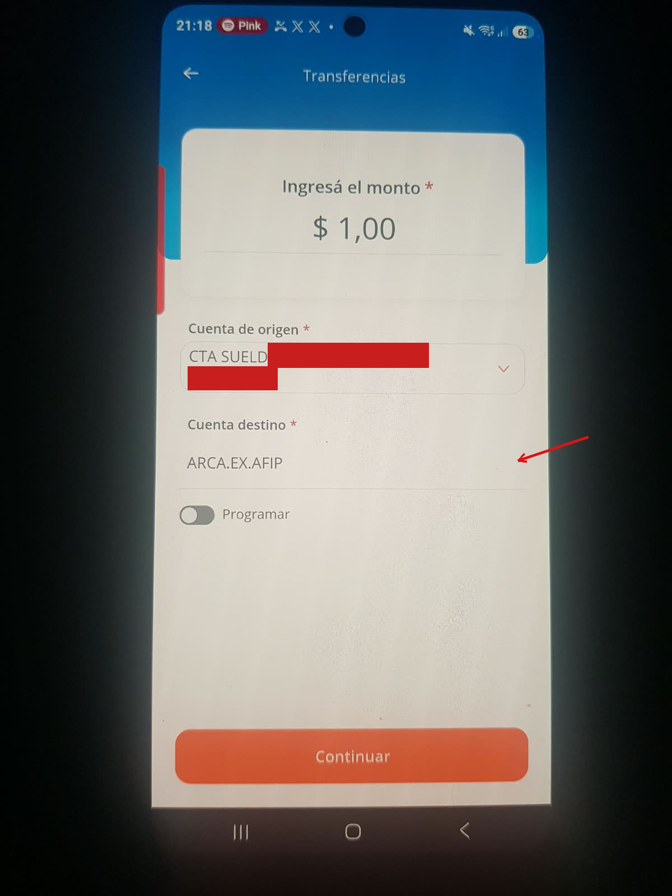
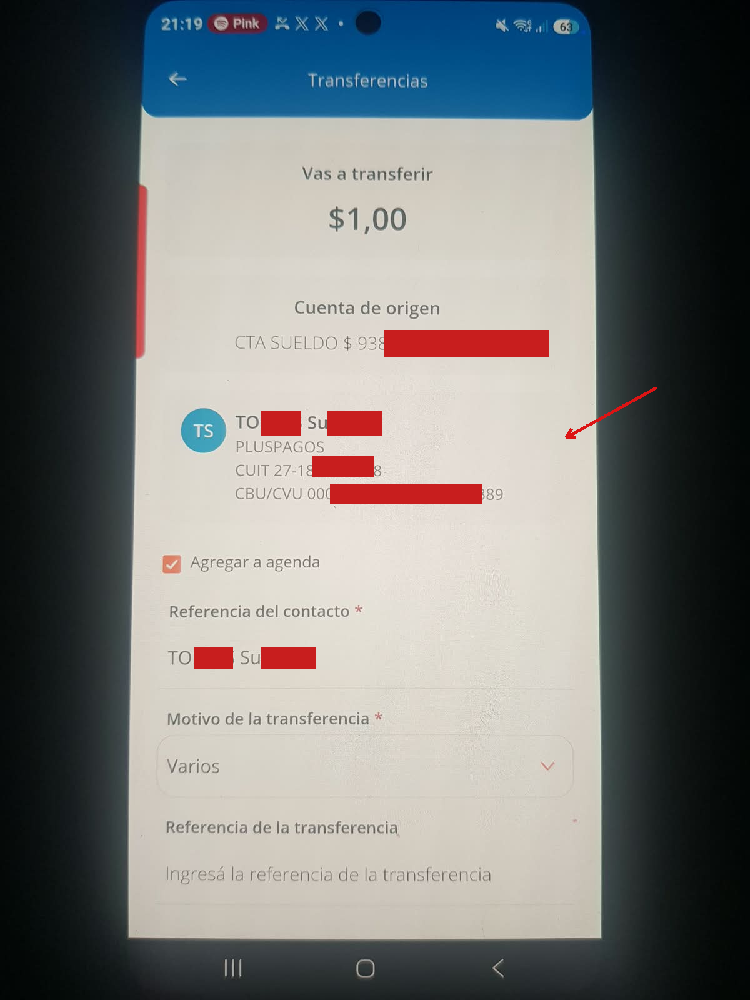

# Write-up — Phishing «Encomienda internacional ARCA (ex-AFIP)»

> Análisis forense de un correo de phishing que suplanta a ARCA (ex-AFIP, Administración de Recaudación y Control Aduanero) para solicitar el pago de un supuesto arancel aduanero, realizado bajo metodología de OSINT pasivo (sin interactuar nunca con enlaces ni adjuntos maliciosos, ya que el correo no contenía ninguno).
>
> 📄 Documento completo, con todas las figuras, la tabla de IOCs y las fuentes citadas: [`writeup_arca_phishing.pdf`](./writeup_arca_phishing.pdf) ([.docx](./writeup_arca_phishing.docx))

## 1. Resumen ejecutivo

El 26 de julio de 2026 ingresó a una casilla de correo personal un mensaje que suplanta la identidad de ARCA (ex-AFIP) para solicitar el pago de un supuesto arancel aduanero sobre una encomienda internacional retenida, mediante transferencia bancaria directa a un alias. A diferencia de un phishing tradicional basado en un enlace o un archivo malicioso, este caso se sostiene enteramente en ingeniería social: el correo no contiene ningún enlace ni adjunto, solo un pretexto administrativo, una cifra exacta y un plazo de un día hábil.

El análisis del encabezado técnico y de la infraestructura de envío determinó que el correo fue remitido desde la casilla real de una empresa serbia legítima y preexistente (Grampex, dedicada a pirometría e interiorismo, con 13 años de antigüedad registral), alojada en un proveedor de hosting compartido (beotel.net). Esto indica, con alta probabilidad, el uso de una cuenta de correo comprometida como vector de envío, en lugar de infraestructura creada específicamente para la campaña — un patrón conocido en la industria como *business email compromise*: el uso de una cuenta de correo corporativa real y comprometida para cometer fraude, en lugar de montar infraestructura falsa desde cero. Además, se verificó de forma activa el estado del alias bancario utilizado en la estafa, lo que permitió documentar un hallazgo adicional relevante: si bien en un primer intento de validación el alias no devolvió resultados, una verificación posterior confirmó que fue reasignado y actualmente se encuentra vigente, asociado a un nuevo titular.

## 2. Contexto y metodología

El correo llegó a una casilla de correo personal el 26 de julio de 2026. Se decidió documentarlo como ejercicio práctico de análisis forense de correo electrónico, aplicando una metodología exclusivamente pasiva: en ningún momento se interactuó con enlaces ni adjuntos (el correo no contenía ninguno), y la única acción activa realizada fue la consulta —sin confirmar transferencia alguna— del estado del alias bancario mencionado en el mensaje, con el único fin de verificar si seguía asociado a un titular.

El objetivo es doble: por un lado, ejercitar y documentar competencias de análisis de encabezados de correo, OSINT (*Open Source Intelligence*, inteligencia de fuentes abiertas: reunir información útil a partir de fuentes públicas y legales, sin acceder a ningún sistema de forma no autorizada) e investigación de infraestructura; por otro, dejar registrado un caso real y vigente de estafa dirigida a usuarios argentinos, con indicadores de compromiso reutilizables para la comunidad.

### 2.1 Principio metodológico

El principio que guía todo el análisis es el siguiente: un atacante controla por completo lo que el correo *dice* —el nombre visible del remitente, el texto del cuerpo, el logo, los colores— pero no puede falsear con la misma facilidad lo que la infraestructura de correo *registra*: la cadena de servidores por los que pasó el mensaje, los resultados de autenticación (SPF/DKIM) y los datos públicos de WHOIS asociados a esa infraestructura. Es el mismo principio que rige un sobre de correo postal tradicional: cualquiera puede escribir cualquier remitente en el frente del sobre, pero el matasellos y la ruta que siguió ese sobre hasta llegar a destino no se pueden falsificar con la misma facilidad.

## 3. Análisis del encabezado del correo

Todo correo electrónico viaja acompañado de un encabezado (*header*): un bloque de información técnica, invisible en el uso normal del correo, que el propio sistema de correo va agregando a medida que el mensaje pasa de servidor en servidor hasta llegar a destino. La mayoría de los proveedores de correo permiten verlo con una opción del tipo "mostrar original" o "ver código fuente del mensaje".

### 3.1 Cadena Received

Dentro del encabezado, los campos "Received" ("recibido") registran cada uno de los servidores por los que pasó el correo en su camino hasta la bandeja de entrada. Se agregan en orden cronológico y cada servidor añade el suyo por encima de los anteriores, de modo que la línea más antigua —la del origen real del envío— queda al final de la cadena, no al principio. En este caso, el primer salto señala a:

```
Received: from [130.49.214.56] (port=44339 helo=130.49.214.56)
	by cpanel18.beotel.net with esmtpsa (TLS1.3)
	(envelope-from <grampex@grampex.rs>)
	for acmluxero@gmail.com;
	Sun, 26 Jul 2026 09:39:11 +0200
```

El servidor que procesó y envió el correo es `cpanel18.beotel.net`, un servidor de hosting compartido en Serbia (proveedor beotel.net / Telekom Srbija), sin ninguna relación aparente con ARCA ni con el territorio argentino. La anotación "esmtpsa (TLS1.3)" solo indica que la conexión viajó cifrada; no aporta ninguna garantía sobre quién es el remitente ni sobre si el contenido es confiable.

### 3.2 From, Return-Path y Reply-To

```
From: ARCA <grampex@grampex.rs>
Reply-To: ARCA <encomiendas@arca.gob.ar>
Return-Path: <grampex@grampex.rs>
```

Estos tres campos suelen confundirse entre sí porque en la bandeja de entrada normal el usuario solo ve uno de ellos: **From** es el remitente que la aplicación de correo le muestra al destinatario; **Return-Path** es la dirección a la que el propio sistema de correo devuelve el mensaje si no pudo entregarse; y **Reply-To** es la dirección a la que efectivamente se dirige la respuesta si el destinatario aprieta "responder". El campo From mostraba el nombre visible "ARCA", pero la dirección real detrás de ese nombre era `grampex@grampex.rs` — un dominio serbio sin relación con la entidad suplantada. El Return-Path apunta también a `grampex.rs`, confirmando que ese es el dominio real emisor. El Reply-To, en cambio, fue configurado con `encomiendas@arca.gob.ar`, un dominio gubernamental legítimo, probablemente para sumar apariencia de autenticidad a simple vista — algo puramente cosmético, ya que el vector de estafa no dependía de que la víctima respondiera el correo, sino de que realizara una transferencia bancaria directa.

### 3.3 Resultados de autenticación (SPF / DKIM)

```
Authentication-Results: mx.google.com;
       dkim=pass header.i=@grampex.rs header.s=default header.b=JJcmudlg;
       spf=pass (google.com: domain of grampex@grampex.rs designates
       195.252.110.169 as permitted sender) smtp.mailfrom=grampex@grampex.rs
```

SPF y DKIM son dos mecanismos que los servidores de correo usan entre sí para confirmar que un mensaje no fue falsificado a mitad de camino. **SPF** (*Sender Policy Framework*) es, en esencia, una lista publicada por el dueño de un dominio con los servidores autorizados a enviar correo en su nombre. **DKIM** (*DomainKeys Identified Mail*) agrega una firma digital al mensaje para verificar que el contenido no fue alterado en el trayecto. Ninguno de los dos evalúa si el contenido del mensaje es honesto: solo certifican de qué servidor salió el correo y que nadie lo modificó en el camino.

Los resultados muestran `spf=pass` y `dkim=pass` — punto que conviene remarcar porque suele generar confusión. Esa validación es legítima, pero para el dominio `grampex.rs`, **no** para `arca.gob.ar`. En este caso, el hallazgo refuerza la hipótesis de una cuenta de correo real y comprometida, y no de un dominio creado desde cero para la campaña: un dominio fraudulento recién registrado normalmente no alcanza a configurar DKIM de forma coherente ni acumula la reputación necesaria para superar los filtros de Gmail con tanta facilidad.

## 4. Análisis del cuerpo del mensaje

El cuerpo del mensaje incluía el nombre completo y el número de CUIL del destinatario real, lo que indica un envío segmentado con datos obtenidos previamente (filtrados o comprados en el mercado de datos robados), y no un spam genérico enviado al voleo. El pretexto es el pago de un arancel aduanero por una encomienda internacional retenida, con un desglose de conceptos que imita el formato de una notificación administrativa real:



El esquema de ingeniería social combina varios elementos clásicos: un monto exacto y no redondo (`$248.104`), que simula el resultado de un cálculo administrativo real y resulta más creíble que una cifra redonda; un plazo artificialmente corto (1 día hábil), pensado para presionar a la víctima a actuar sin verificar; y la instrucción de enviar el comprobante a una casilla con apariencia oficial (`encomiendas@arca.gob.ar`) para reforzar la sensación de trámite legítimo. A diferencia de los esquemas de phishing más comunes, no hay ningún enlace ni formulario involucrado: el mecanismo de estafa es, en sí mismo, una transferencia bancaria directa a un alias (`ARCA.EX.AFIP`), lo que simplifica el ataque y a la vez lo vuelve más difícil de detectar por filtros automáticos orientados a URLs maliciosas.

## 5. Investigación de infraestructura (OSINT)

### 5.1 WHOIS y geolocalización del dominio emisor

**WHOIS** es un servicio público y gratuito que permite consultar los datos de registro de un dominio de internet: quién lo registró, cuándo, bajo qué proveedor y con qué servidores de nombres está configurado. La IP de origen del correo (`195.252.110.169`) pertenece a un bloque autorizado explícitamente por el propio registro SPF del dominio `grampex.rs`:

```
v=spf1 ip4:195.252.110.168 ip4:195.252.110.169 ip4:195.252.110.170 +a +mx -all
```

Distintas fuentes consultadas durante la investigación (el encabezado del correo frente a una consulta de geolocalización de IP) citaban direcciones distintas dentro de ese mismo rango —`.168` y `.169`— que podrían interpretarse erróneamente como una inconsistencia. En realidad, el SPF autoriza explícitamente las tres IPs del bloque /30 (un pequeño grupo de cuatro direcciones consecutivas que suelen asignarse juntas a un mismo cliente de hosting) como remitentes válidos, por lo que ambas direcciones corresponden a la misma infraestructura legítima, no a un error de rastreo.

El registro WHOIS del dominio `grampex.rs` muestra una antigüedad registral desde el 10 de mayo de 2013 — trece años al momento del análisis —, lo que descarta por completo que se trate de un dominio creado recientemente con fines de phishing.

### 5.2 Análisis en VirusTotal

La consulta del dominio `www.grampex.rs` en VirusTotal no arrojó ninguna detección de motores de seguridad (0 de 91), resultado consistente con tratarse de infraestructura legítima y no de un dominio malicioso creado ad-hoc.



La pestaña Details confirma el registro SPF ya mencionado, los servidores de nombres (`ns.beotel.rs` / `ns8.beotel.net`) y el registro SOA apuntando también a `cpanel18.beotel.net` — todos indicadores consistentes de un hosting compartido bajo el mismo proveedor serbio. El bloque de WHOIS Lookup muestra, además, el mismo Tax ID que figura en los resultados de Google para la empresa real Grampex (pirometría e interiorismo, Belgrado), lo que confirma que el dominio corresponde efectivamente a esa empresa y no a una entidad ficticia.



### 5.3 Patrón de hosting compartido (cPanel/WHM)

**cPanel** es un programa con interfaz web que los proveedores de hosting ofrecen a sus clientes para que administren por sí mismos su sitio web y sus casillas de correo, sin necesidad de conocimientos técnicos avanzados. **WHM** (*WebHost Manager*) es la versión equivalente, pensada para que el propio proveedor administre centralizadamente a todos sus clientes sobre un mismo servidor.

La pestaña Relations de VirusTotal reveló tres subdominios "hermanos" que resuelven a la misma IP que `grampex.rs`: `cpanel.grampex.rs`, `cpcalendars.grampex.rs` y `webmail.grampex.rs`. Esta combinación es la huella característica de un panel cPanel/WHM en un servidor de hosting compartido — es decir, un mismo servidor físico aloja los correos y sitios web de múltiples clientes del proveedor, entre ellos Grampex. Este hallazgo identifica con precisión a qué proveedor de hosting correspondería dirigir un reporte de abuso (ver sección 5.5).



Como referencia visual del comercio real cuya cuenta de correo se vio comprometida, se incluye a continuación una captura de su sitio web — una empresa serbia de pirometría e interiorismo, sin ninguna relación con organismos argentinos.



### 5.4 Threat-hunting proactivo con dnstwist

**Threat-hunting** ("caza de amenazas") es la práctica de buscar activamente indicios de riesgo antes de que se produzca un incidente concreto, en lugar de limitarse a reaccionar una vez que algo ya ocurrió. Más allá del análisis del correo recibido, se incorporó una instancia adicional de investigación proactiva de este tipo: la búsqueda de dominios *typosquatting* registrados a partir del dominio legítimo de ARCA (`arca.gob.ar`).

El **typosquatting** consiste en registrar dominios cuyo texto es visual o tipográficamente similar al de una marca u organismo real, aprovechando errores de tipeo del usuario o variaciones difíciles de distinguir a simple vista (intercambiar dos letras, agregar o quitar un carácter, sustituir una letra por otra visualmente parecida, cambiar la extensión del dominio). Es una técnica frecuentemente utilizada como infraestructura de apoyo para campañas de phishing: el atacante registra una de estas variantes y monta ahí una página que imita al sitio original.

`dnstwist` es una herramienta de código abierto que automatiza este proceso: a partir de un dominio semilla, genera algorítmicamente el universo de variantes plausibles (sustitución, omisión, repetición y transposición de caracteres, bit-squatting, homóglifos, cambios de extensión, etc.) y luego intenta resolverlas por DNS para determinar cuáles están efectivamente registradas. El objetivo no fue analizar el correo recibido en sí —ya investigado en profundidad en las secciones anteriores—, sino adoptar una postura de vigilancia proactiva: identificar si existe infraestructura adicional, ya registrada y lista para usarse, que pudiera emplearse en futuras campañas de suplantación del mismo organismo.

```
$ dnstwist -r arca.gob.ar
```



Se evaluaron 1.081 variantes posibles del dominio legítimo, de las cuales únicamente dos (además del dominio original) resultaron estar efectivamente registradas: `arcat.gob.ar` y `arba.gob.ar`. En ambos casos se trata de coincidencias de nomenclatura con otros organismos de recaudación tributaria provincial, reales y preexistentes — ARCAT (Agencia de Recaudación de Catamarca) y ARBA (Agencia de Recaudación de la Provincia de Buenos Aires) —, no de infraestructura maliciosa ni de dominios parqueados con fines de phishing. Al momento del análisis no se identificó ninguna variante típica de typosquatting registrada con intención de suplantar a ARCA. Se trata de un hallazgo "negativo", pero igualmente valioso: se recomienda repetir este chequeo periódicamente, dado que el registro de un dominio similar puede producirse en cualquier momento posterior al análisis.

### 5.5 Reporte de abuso ante el proveedor de hosting (beotel.net)

El primer salto de la cadena Received apunta a `cpanel18.beotel.net`, correspondiente al proveedor de hosting serbio Beotel (ISP Telekom Srbija). Este dato no identifica al remitente que se hace pasar por ARCA, sino a la infraestructura técnica que efectivamente procesó y envió el correo — y es, por lo tanto, el dato relevante a la hora de reportar el abuso ante quien tiene capacidad real de actuar: el proveedor de hosting, no el organismo suplantado.

El reporte de abuso (*abuse report*) es el mecanismo estándar de la industria para notificar a un proveedor de infraestructura que uno de sus clientes o recursos está siendo utilizado con fines maliciosos. La mayoría de los proveedores publican una dirección de contacto dedicada a este fin (habitualmente `abuse@<dominio>`), que puede identificarse de dos formas complementarias:

- Los encabezados **X-AntiAbuse**: un conjunto de líneas que algunos servidores de correo agregan automáticamente a cada mensaje saliente, pensadas específicamente para incluirse al redactar un reporte de abuso. En este caso identifican `cpanel18.beotel.net` como *Primary Hostname* (el **hostname**, o "nombre de host", es el nombre que identifica a un servidor dentro de una red, de forma equivalente a cómo un nombre y apellido identifican a una persona) del servidor que efectivamente procesó y envió el correo.
- La información de contacto de abuso publicada en el registro WHOIS del rango de IP o del dominio del proveedor.

```
X-AntiAbuse: This header was added to track abuse, please include it with any abuse report
X-AntiAbuse: Primary Hostname - cpanel18.beotel.net
X-AntiAbuse: Original Domain - gmail.com
X-AntiAbuse: Sender Address Domain - grampex.rs
```

> **Aclaración metodológica:** en el marco de este documento se explica el proceso y se deja preparada la evidencia necesaria para un reporte, pero no se efectúa el envío real del mismo, dado que excede el alcance de este análisis.

## 6. Verificación del alias bancario

Se intentó validar el alias bancario (`ARCA.EX.AFIP`) mencionado en el correo, sin realizar ninguna transferencia, únicamente consultando la pantalla de destino de una transferencia para verificar si figuraba asociado a algún titular. Un primer intento, realizado desde la aplicación bancaria habitual, fue bloqueado por el propio sistema del banco tras detectar reiterados intentos de consulta — una medida de seguridad estándar que, en este caso, impidió completar la verificación por esa vía.



Una verificación posterior, realizada desde un dispositivo distinto, sí pudo completarse y arrojó un hallazgo relevante: el alias `ARCA.EX.AFIP`, que en julio de 2026 no devolvía ningún titular asociado (lo cual sugería que había sido dado de baja o denunciado tras la campaña de phishing), se encuentra actualmente vigente y resuelve a una cuenta activa a nombre de un nuevo titular.



Este hallazgo no permite, por sí solo, determinar con certeza qué ocurrió entre ambos momentos. Es consistente con al menos dos explicaciones: que el alias haya sido efectivamente dado de baja por la entidad bancaria tras ser reportado, y posteriormente liberado y reasignado a un titular distinto conforme a sus políticas internas; o que el alias nunca haya sido dado de baja y el titular actual esté vinculado —a sabiendas o no— al esquema original. En este último escenario, cabe la posibilidad de que la cuenta actual esté operando como una "cuenta mula" (una cuenta bancaria utilizada para recibir y redirigir fondos de origen ilícito, muchas veces a nombre de una persona ajena a la maniobra, captada mediante engaño o falsas ofertas laborales) o que el titular haya sido víctima de una suplantación de identidad para la apertura de la cuenta. No existe, a partir de la evidencia reunida, forma de confirmar cuál de estos escenarios es el correcto, por lo que se documenta el hallazgo sin atribuir responsabilidad alguna al titular actual del alias.

## 7. Conclusiones y recomendaciones

### 7.1 Conclusiones técnicas

- El correo no proviene de ARCA; el remitente visible es una etiqueta de presentación sobre una cuenta de correo real y ajena al organismo (`grampex@grampex.rs`).
- Los resultados de autenticación SPF/DKIM en "pass" son legítimos, pero corresponden al dominio `grampex.rs`, no a `arca.gob.ar` — un punto que puede inducir a una interpretación errónea si no se audita correctamente a quién pertenece el dominio validado.
- La explicación más probable no es un dominio creado ad-hoc para el ataque, sino una cuenta de correo real y preexistente (13 años de antigüedad) que fue comprometida y reutilizada como vector de envío.
- El relevamiento proactivo con dnstwist no encontró, al momento del análisis, infraestructura de typosquatting adicional registrada contra ARCA — un hallazgo negativo que conviene repetir periódicamente.
- El alias bancario usado en la estafa, dado de baja en un primer momento, se encuentra hoy reasignado a un nuevo titular, sin que la evidencia disponible permita determinar si ese titular está vinculado al esquema original.

### 7.2 Recomendaciones para el usuario final

- Ningún organismo público real solicita el pago de aranceles, multas o trámites mediante transferencia a un alias bancario personal, y mucho menos bajo la presión de un plazo artificialmente corto.
- Ante cualquier notificación de este tipo, la verificación debe hacerse siempre por un canal oficial distinto al del correo recibido (el sitio web o la línea telefónica pública del organismo), nunca respondiendo ni utilizando los datos de contacto que el propio correo sospechoso provee.
- Un resultado de autenticación SPF/DKIM válido no certifica que el contenido de un correo sea confiable: solo confirma que el servidor emisor está autorizado para ese dominio concreto, que puede no ser el dominio que el mensaje dice representar.
- Investigar la infraestructura detrás del remitente (WHOIS, antigüedad del dominio, patrones de hosting compartido) antes de descartar o confirmar un hallazgo basándose únicamente en los resultados de autenticación del correo.

## 8. Indicadores de compromiso (IOCs)

| Tipo | Valor |
|---|---|
| Dominio remitente (comprometido) | `grampex.rs` |
| Dirección de correo remitente | `grampex@grampex.rs` |
| IP de origen | `195.252.110.169` (bloque autorizado: .168–.170) |
| Hostname del servidor de envío | `cpanel18.beotel.net` |
| Proveedor de hosting | `beotel.net` (Telekom Srbija) |
| Reply-To (suplantado, cosmético) | `encomiendas@arca.gob.ar` |
| Alias bancario de destino | `ARCA.EX.AFIP` |
| Asunto del correo | `Encomienda Internacional - [nombre] - CUIL [número]` |
| Entidad suplantada | ARCA (ex-AFIP) |
| Monto solicitado | `$248.104` |
| Message-ID | `ae07bdef1bcd6d587bd48d26d20c767c4cb42b65@grampex.rs` |

## 9. Fuentes consultadas

- Archivo original del correo (`.eml`), conservado por el autor.
- VirusTotal — análisis de dominio, WHOIS y relaciones de infraestructura ([virustotal.com](https://www.virustotal.com)).
- `dnstwist` — generación y resolución de variantes de typosquatting, ejecutado localmente ([github.com/elceef/dnstwist](https://github.com/elceef/dnstwist)).
- Registros públicos de WHOIS del dominio `grampex.rs`.
- Pantalla de verificación de alias bancario de la aplicación del banco del autor (consulta, sin transferencia).
