# Write-up — Phishing «Actualización de envío OCA»

> Análisis forense de un correo de phishing que suplanta a la empresa de encomiendas OCA, realizado bajo metodología de OSINT pasivo (sin visitar en ningún momento los enlaces maliciosos desde un navegador).
>
> 📄 Documento completo, con todas las figuras, la tabla de IOCs y las fuentes citadas: [`writeup_oca_phishing.pdf`](./writeup_oca_phishing.pdf) ([.docx](./writeup_oca_phishing.docx))

## 1. Resumen ejecutivo

El 19 de octubre de 2026 ingresó a la casilla de correo del autor un mensaje que se presenta como una notificación de envío de la empresa de logística OCA. El mensaje llegó directamente a la carpeta de Spam de Gmail, sin intervención del usuario, lo que ya constituye un primer indicio de origen no confiable. El análisis técnico detallado en este documento confirma que se trata de un correo de phishing: no proviene de OCA, utiliza un servicio de almacenamiento de Google como pantalla para encubrir su verdadero destino, y ambos botones que ofrece —"Confirmar datos de entrega" y "Cancelar suscripción"— conducen, en el fondo, al mismo sistema de rastreo del atacante.

Para quien no está familiarizado con estos términos: el phishing es una técnica de engaño en la que alguien se hace pasar por una empresa o persona de confianza —un banco, una empresa de encomiendas, un organismo público— con el objetivo de que la víctima entregue datos personales, credenciales de acceso o información de pago, o bien de que instale software malicioso sin saberlo. Es el equivalente digital de recibir en la puerta de casa a alguien disfrazado de empleado de una empresa de reparto, que en realidad busca que uno le abra la puerta y le entregue algo de valor.

El hallazgo central de este informe es que los seis motores de seguridad que marcaron la página de destino como maliciosa coinciden en algo más: la infraestructura detrás de este correo no fue creada el mismo día del envío, sino que lleva operativa, sin ser dada de baja, desde al menos septiembre de 2024 —más de dos años— lo cual sugiere una campaña sostenida de reutilización de la misma infraestructura contra distintas marcas de logística.

## 2. Contexto y metodología

Este documento forma parte de una serie de análisis de campañas de phishing y smishing (phishing por SMS) recibidas de forma directa por el autor, realizados como práctica de investigación en ciberseguridad defensiva. El objetivo no es exponer ni dañar la infraestructura del atacante, sino documentar de forma rigurosa cómo opera este tipo de engaño, para que sirva tanto de referencia técnica como de material de concientización para personas sin formación en el área.

### 2.1 Principio metodológico: OSINT pasivo

Todo el trabajo se realizó bajo un único principio, que se mantiene en todos los casos analizados por el autor: en ningún momento se visitaron los enlaces maliciosos desde un navegador convencional. Hacerlo expondría al equipo del investigador a la misma amenaza que se busca documentar, y podría además alertar al atacante de que su infraestructura está siendo observada. En su lugar, se utilizó exclusivamente información disponible de forma pública o derivada de herramientas especializadas de análisis —lo que en la disciplina se conoce como OSINT, "Open Source Intelligence" o inteligencia de fuentes abiertas— y capturas de pantalla generadas por el propio atacante al momento de redactar el correo.

- Lectura directa del archivo `.eml` (el correo en su formato técnico original) para examinar encabezados, remitente real y código fuente.
- Decodificación manual de los parámetros ocultos en los enlaces, sin ejecutarlos.
- Consulta de reputación de las URL involucradas mediante VirusTotal, a través de capturas de pantalla, sin cargar la página en un navegador.
- Consulta de reputación de las direcciones IP identificadas mediante AbuseIPDB, servicio público de reportes de abuso de infraestructura.

## 3. El mensaje recibido

El correo llegó el 19 de octubre de 2026 a las 4:29 a. m. y Gmail lo clasificó automáticamente como Spam, sin que el autor lo marcara manualmente. La Figura 1 muestra la vista del mensaje dentro de esa carpeta, con el aviso estándar de Gmail que advierte que el contenido es similar a otros mensajes identificados previamente como spam.

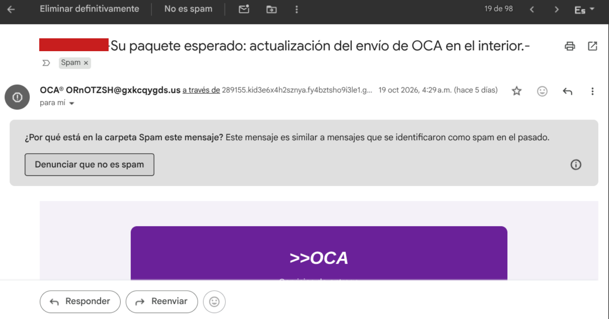

El asunto del correo comienza con el nombre de usuario de la casilla de destino, seguido de «-Su paquete esperado: actualización del envío de OCA en el interior.-». La inclusión del nombre de usuario al comienzo del asunto es una técnica de personalización automatizada: el atacante envía el mismo mensaje a miles de direcciones, y un script inserta el nombre de cada destinatario en el asunto y en el cuerpo para que el mensaje se sienta dirigido específicamente a esa persona, aumentando la probabilidad de que lo abra. Es una variante del mismo principio que usa un vendedor telefónico cuando dice el nombre de uno repetidas veces: genera una falsa sensación de trato personalizado.

### 3.1 Quién envió realmente el correo

Al desplegar el detalle técnico del remitente en Gmail (opción "Mostrar original" o el ícono de información junto al nombre del remitente), se revela la dirección real detrás del nombre visible "OCA®":

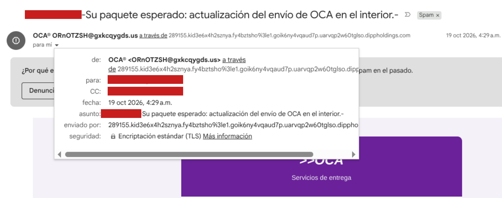

El remitente visible "OCA®" es solo una etiqueta de presentación ("display name") que cualquier persona puede configurar libremente al enviar un correo, de la misma manera que cualquiera puede escribir el nombre que quiera en el remitente de una carta de papel. La dirección real detrás de esa etiqueta es `ORnOTZSH@gxkcqygds.us` —una combinación de caracteres sin relación alguna con OCA, típica de un dominio generado automáticamente y de corta vida, pensado para usarse en una sola campaña y luego ser descartado.

El correo fue además reenviado "a través de" el dominio `289155.kid3e6x4h2sznya.fy4bztsho9i3le1.goik6ny4vqaud7p.uarvqp2w60tglso.dippholdings.com`, una cadena de subdominios anidados que corresponde a un servicio de envío masivo de correo contratado por el atacante (lo que en la jerga se llama un "ESP" o proveedor de servicios de email). El uso de subdominios generados dinámicamente, con nombres aleatorios en cada tramo, es una técnica habitual para dificultar que los filtros antispam bloqueen de forma permanente el dominio raíz: si una dirección se bloquea, la siguiente campaña simplemente genera otra combinación distinta.

### 3.2 El cuerpo del mensaje y la técnica de persuasión

El cuerpo del correo imita, con bastante cuidado visual, el estilo corporativo de OCA: colores institucionales, un encabezado con el logotipo estilizado y un bloque central que informa sobre un envío retenido.

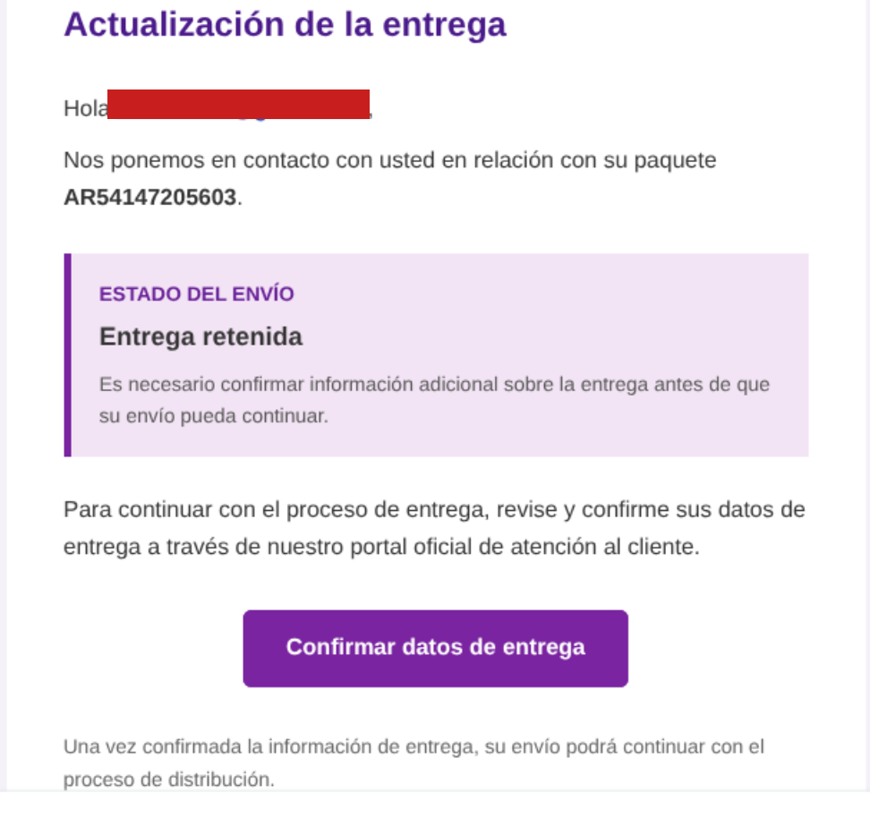

El mensaje recurre a una técnica de ingeniería social muy difundida: generar una sensación de urgencia y de pérdida inminente. Le informa a la víctima que tiene un paquete "retenido" y que debe "confirmar información adicional" para que la entrega continúe. Es el mismo mecanismo psicológico que explota una llamada telefónica que avisa que la tarjeta de crédito está a punto de ser bloqueada: el objetivo no es que la persona piense con calma, sino que actúe rápido, antes de que la urgencia se disipe y la cautela regrese.

El número de seguimiento `AR54147205603` que aparece en el correo no corresponde a ningún envío real: es simplemente un valor con formato plausible, generado para dar verosimilitud al mensaje. Ni OCA ni ninguna empresa de logística legítima solicita "confirmar datos de entrega" por un enlace genérico enviado por correo cuando el destinatario no inició ningún trámite ni está esperando un envío identificable.

### 3.3 Una técnica adicional: el relleno invisible

Al examinar el código fuente completo del correo (el archivo `.eml`), se encontró, después del cuerpo visible del mensaje, un bloque de texto delimitado por el comentario HTML `<!------------ START NEGATIVE ------------>` que contiene un artículo sobre el cuidado de limoneros y fragmentos sueltos de campañas de marketing de empresas reales y ajenas al caso (entre ellas, comunicaciones de YNAB, Enterprise Rent-A-Car y Event Temple). Este contenido nunca llega a verse en la pantalla del destinatario.

La explicación técnica es la siguiente: los filtros antispam no solo analizan enlaces y remitente, también evalúan el vocabulario general del correo. Un mensaje compuesto casi en su totalidad por palabras asociadas a urgencia y pagos ("retenido", "confirmar", "paquete") tiene más probabilidad de ser marcado como sospechoso. Al agregar, oculto, un bloque grande de texto "inocente" y variado —temas de jardinería, fragmentos de boletines corporativos legítimos—, el atacante intenta diluir estadísticamente esas señales de alerta y mejorar sus chances de llegar a la bandeja de entrada principal en lugar de Spam. En este caso la técnica no fue del todo efectiva, ya que Gmail igual clasificó el correo como Spam, pero es una práctica habitual que vale la pena documentar porque explica por qué, a veces, un correo de phishing "se siente" raro al leerlo incluso antes de analizar ningún enlace.

## 4. Anatomía del engaño: dos botones, un mismo destino

El correo ofrece dos acciones aparentemente opuestas: hacer clic en «Confirmar datos de entrega» para continuar con el supuesto envío, o hacer clic en «Cancelar suscripción» al pie del mensaje, para quien prefiera no seguir recibiendo este tipo de comunicaciones.

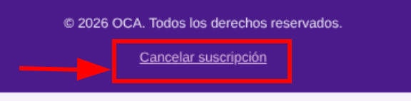

A simple vista, ambos caminos parecen tener efectos distintos para la víctima: uno avanza con el trámite, el otro lo detiene. Decodificando técnicamente ambos enlaces se descubre que esa distinción es solo apariencia.

```
Confirmar datos de entrega  →  go=1&s1=2399494&s2=534077270&s3=GLB
Cancelar suscripción       →  go=2&s1=2399494&s2=534077270&s3=GLB
```

Ambos fragmentos están codificados en Base64, una forma estándar de representar texto como una cadena de caracteres (no es cifrado ni ocultamiento real; es una transformación reversible con herramientas de uso común). Al decodificarlos, se ve que los dos enlaces comparten exactamente los mismos identificadores de campaña (`s1`) y de destinatario (`s2`) —este último coincide, de hecho, con el número que identifica al correo en los servidores del atacante (su Message-ID)— y difieren únicamente en el valor de "go": 1 para un botón, 2 para el otro.

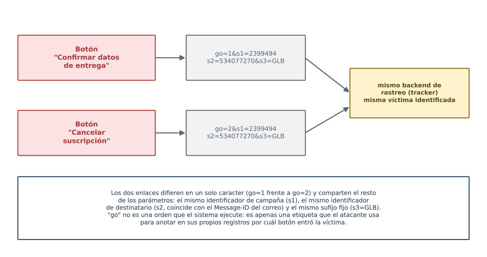

En otras palabras, no existe una opción real de "baja" o "cancelación". El botón «Cancelar suscripción», que en un correo legítimo debería retirar a la persona de una lista de envíos, aquí cumple la misma función que el botón de "continuar": informarle al atacante que esa dirección de correo está activa y que una persona real hizo clic en el mensaje. Es una trampa habitual: imitar una puerta de salida que en realidad conduce al mismo lugar, para capturar también a las víctimas más cautelosas, que intentan no caer en la trampa evitando el botón principal.

## 5. Investigación de infraestructura (OSINT)

Ambos enlaces fueron analizados —sin visitarlos en un navegador— a través de VirusTotal, un servicio gratuito que agrega los resultados de decenas de motores de seguridad y, cuando es posible, reconstruye la cadena completa de redirecciones que atraviesa una URL antes de llegar a su destino final.

### 5.1 Botón «Cancelar suscripción»: la cadena completa

El primer análisis, realizado el 24 de octubre de 2026 a las 03:42:09 UTC, logró seguir el enlace hasta el final. Seis de los noventa y tres motores de seguridad consultados marcaron la URL como maliciosa: BitDefender y G-Data la identifican como «Phishing», ESET como «Malware», Webroot como «Malicious» y Fortinet y Phishing Database coinciden también en «Phishing».

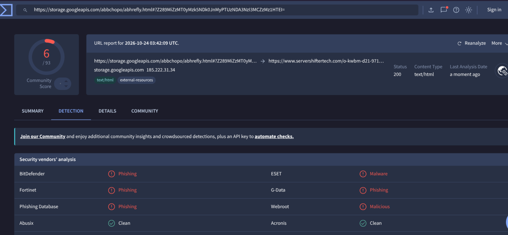

La pestaña de resumen confirma que el enlace, que empieza en `storage.googleapis.com` (el servicio de almacenamiento en la nube de Google), termina redirigiendo a `www.servershiftertech.com`, servido desde la dirección IP `185.222.31.34`, ubicada en Estados Unidos.

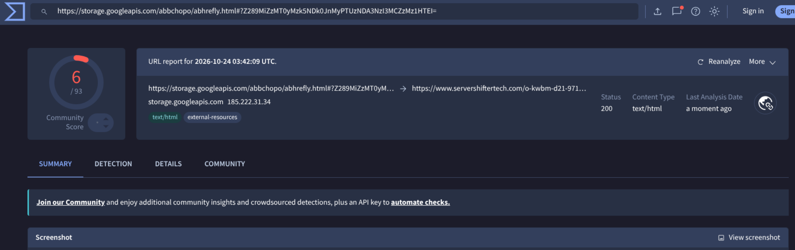

El detalle de la navegación («Page Stats») muestra que, para llegar a ese destino final, el navegador automatizado de VirusTotal tuvo que realizar 28 solicitudes de red distintas, atravesando seis dominios y cinco direcciones IP diferentes, todas dentro de un mismo país. Es una cantidad de pasos considerablemente alta para lo que, a los ojos de la víctima, es un solo clic: cada salto adicional es una oportunidad para que el atacante encubra mejor el destino real y dificulte que las herramientas de seguridad automatizadas sigan el rastro completo.

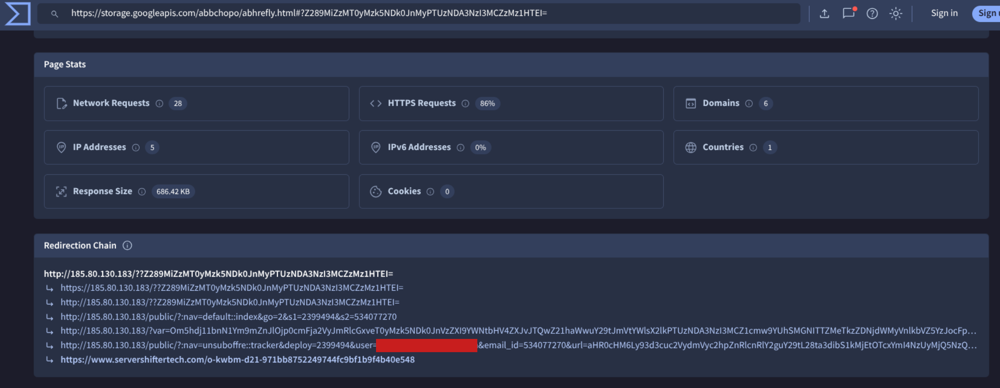

La cadena de redirección detallada, visible en la misma herramienta, revela un salto especialmente relevante: en uno de los tramos intermedios, la URL incluye de forma literal el parámetro `user=[dirección de correo del destinatario, redactada en este documento]&email_id=534077270`. Es decir, en algún punto del recorrido, la dirección de correo completa de la víctima viaja embebida en texto plano dentro de la propia URL de redirección, junto al mismo identificador numérico ya visto en el botón. Esto confirma, de forma independiente a la decodificación manual, que el sistema del atacante identifica individualmente a cada destinatario en cada clic que realiza, sin importar cuál de los dos botones haya usado.

> **Nota:** esto no significa que la víctima haya hecho clic en el enlace. La URL personalizada ya trae el identificador del destinatario embebido desde el propio correo; cualquier solicitud a esa URL exacta —incluida la de un escáner automatizado como VirusTotal, usado aquí sin abrir nunca la página en un navegador— dispara en el backend del atacante la misma resolución y expone el correo del destinatario en el siguiente salto. Es decir, el solo hecho de analizar una URL personalizada ya constituye un contacto controlado con la infraestructura del atacante, no una interacción libre de riesgo.

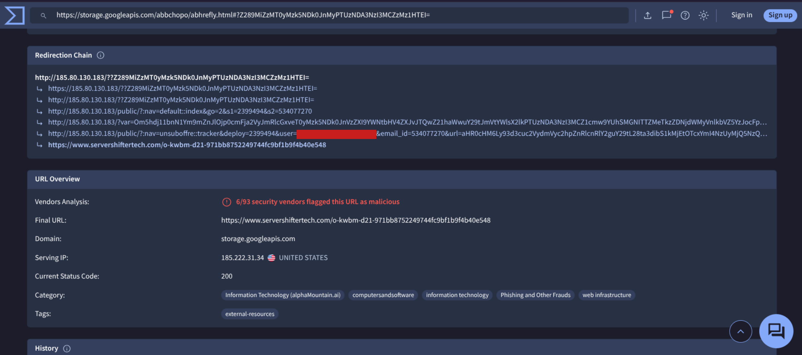

La ficha de «URL Overview» resume el resultado: destino final `servershiftertech.com`, servido desde la IP `185.222.31.34` en Estados Unidos, con código de respuesta HTTP 200 (es decir, la página cargó sin errores) y clasificada por los propios sistemas de categorización de VirusTotal bajo la etiqueta «Phishing and Other Frauds».

### 5.2 Botón «Confirmar datos de entrega»: mismo origen, comportamiento distinto

El segundo enlace —el del botón principal del correo— fue analizado por separado, el mismo día a las 04:09:36 UTC. A diferencia del anterior, este análisis no logró completar ninguna redirección: «Network Requests» y «Domains» aparecen en cero, y el campo «Final URL» queda vacío. Sin embargo, los mismos seis motores de seguridad —con la incorporación de Sophos y Forcepoint ThreatSeeker en lugar de otros dos vendors— siguen marcando la URL como maliciosa.

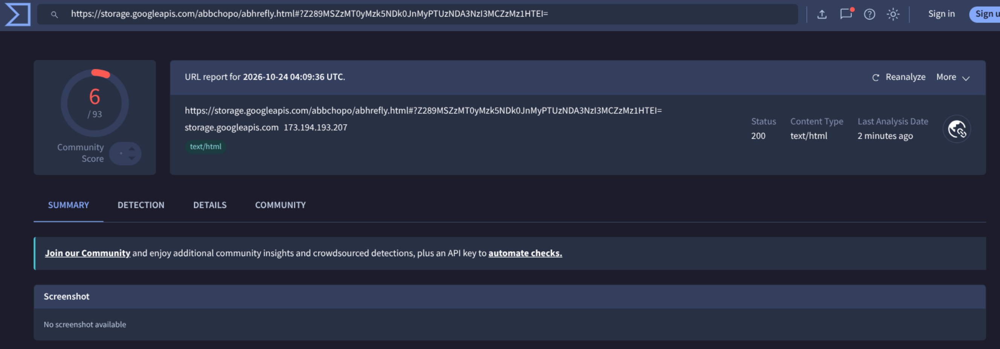

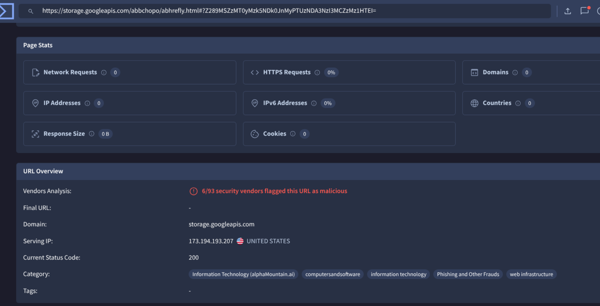

Esta diferencia de comportamiento entre un análisis y otro es, en sí misma, un hallazgo técnico relevante. Una explicación habitual para este patrón es que la infraestructura del atacante limita el redireccionamiento real a un uso por token: una vez que el sistema de rastreo asocia una visita a un identificador de destinatario, visitas posteriores desde la misma dirección —o desde una herramienta automatizada de análisis como la de VirusTotal— pueden recibir una respuesta distinta o simplemente no completar la redirección, precisamente para dificultar que un analista repita la prueba y reconstruya la cadena completa. Es una variante del mismo principio que usa un estafador telefónico que cuelga apenas detecta que quien atiende no es la persona esperada.

La dirección IP que respondió en este segundo análisis, `173.194.193.207`, pertenece a la propia red de Google (es, de hecho, el rango habitual desde el cual Google sirve contenido de Cloud Storage), lo cual es coherente con el hecho de que, en este intento, la respuesta nunca llegó a abandonar la infraestructura de Google rumbo al servidor del atacante.

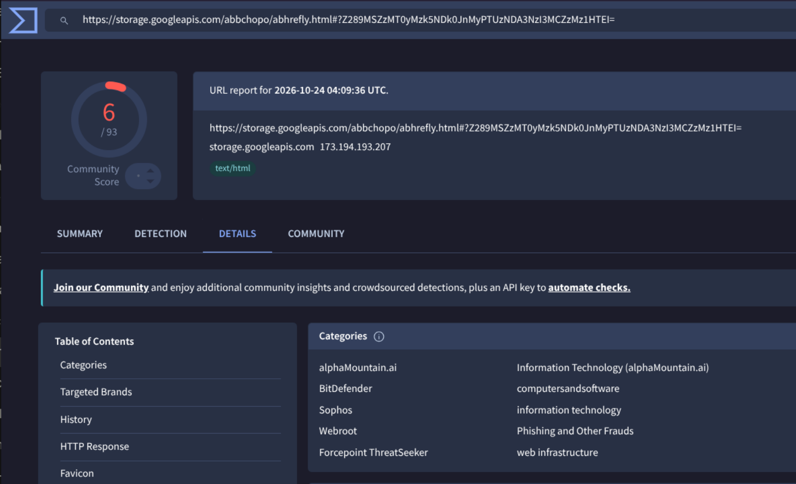

### 5.3 Un dato clave: la antigüedad real del archivo

El detalle técnico de la respuesta HTTP —la información que el servidor de Google devuelve junto con la propia página— incluye un campo llamado «Last-Modified» (última modificación), que indica cuándo fue subido por última vez el archivo que actúa como página intermedia.

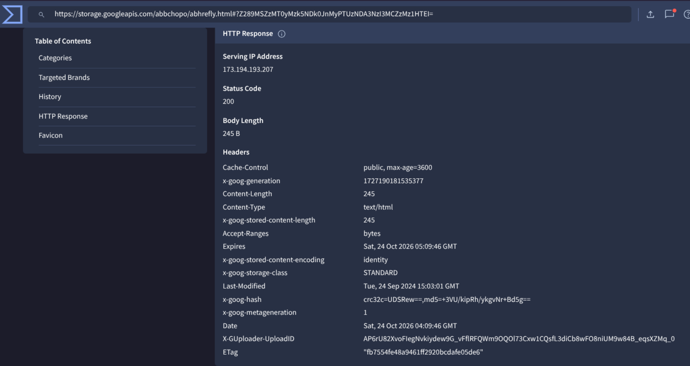

Ese campo indica martes 24 de septiembre de 2024, más de dos años antes de que este correo en particular llegara a la casilla del autor. Esto significa que el archivo señuelo —la página intermedia que vive dentro del almacenamiento de Google y que sirve de puente hacia el destino final— no fue creado para esta campaña puntual contra OCA: es una pieza de infraestructura reutilizable, subida una sola vez y usada repetidamente a lo largo del tiempo en campañas distintas, probablemente contra distintas marcas de logística, simplemente cambiando el contenido visual del correo y el destino final al que apunta el parámetro de rastreo. Es, para usar una analogía, como un disfraz genérico que un estafador reutiliza cambiando solo la etiqueta con el nombre de la empresa que va a imitar cada vez.

### 5.4 Reputación de las direcciones IP involucradas

Se consultó también, de forma independiente, la reputación de las dos direcciones IP que aparecen como servidores reales detrás de la cadena de redirección, utilizando AbuseIPDB, una base de datos pública donde administradores de sistemas de todo el mundo reportan direcciones IP que detectaron participando en actividad abusiva.

- **185.80.130.183** — registrada a nombre de UAB ESNET, un proveedor de hosting con sede en Lituania. Existen reportes previos de esta misma dirección participando en campañas de phishing que suplantan a empresas de logística internacionales como UPS y DHL, siguiendo un patrón de redirección prácticamente idéntico al documentado en este informe.
- **185.222.31.34** — registrada a nombre de New Horizon Hosting, con sede en Chicago, Estados Unidos. Un reporte de apenas cuatro días antes de este análisis identifica de forma explícita el dominio `servershiftertech.com` —el mismo que aparece como destino final en la Sección 5.1— como un sitio de robo de credenciales.

La coincidencia entre lo reportado de forma independiente por terceros en AbuseIPDB y lo observado directamente en este caso refuerza la conclusión de que no se trata de un hecho aislado, sino de infraestructura comercial de phishing, probablemente ofrecida como servicio a distintos operadores, reutilizada contra múltiples marcas de logística de forma simultánea o sucesiva.

## 6. Visión de conjunto de la infraestructura

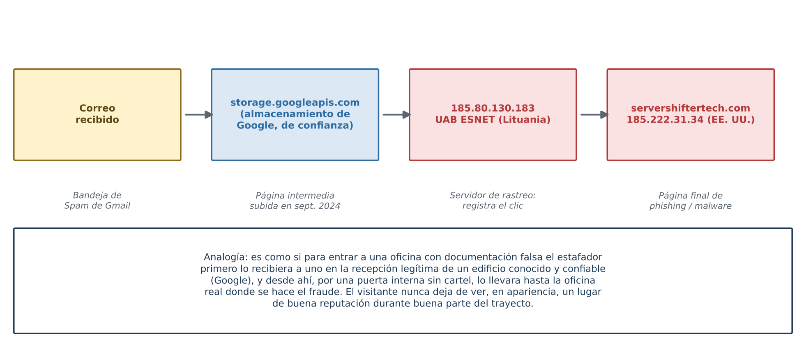

El patrón general de esta campaña puede resumirse en tres capas, cada una cumpliendo una función distinta dentro del engaño:

- **Capa de presentación:** el correo en sí, diseñado para imitar visualmente a OCA y generar urgencia en quien lo lee.
- **Capa de encubrimiento:** el uso de `storage.googleapis.com`, un dominio de altísima reputación, como primer salto, para que cualquier filtro o persona que revise el enlace a simple vista vea un dominio de Google y lo considere confiable.
- **Capa de rastreo y destino final:** el servidor de rastreo en Lituania, que identifica a la víctima y decide hacia dónde reenviarla, y el servidor final en Estados Unidos, donde efectivamente se produce el robo de información.

Esta separación en capas no es casual: es una práctica estándar en kits de phishing comerciales, porque permite que, si una de las piezas es detectada y dada de baja —por ejemplo, si Google retira el archivo intermedio de su almacenamiento—, el resto de la infraestructura (el servidor de rastreo y el destino final) siga intacta y lista para ser reutilizada con un nuevo archivo intermedio en otro servicio de confianza.

## 7. Conclusiones y recomendaciones

### 7.1 Conclusiones técnicas

- El correo no proviene de OCA; el remitente visible es una etiqueta falsa sobre una dirección de dominio desechable.
- Los dos botones del correo —uno para "continuar" y otro para "cancelar"— convergen en el mismo sistema de rastreo del atacante; no existe una opción real de exclusión.
- La infraestructura utilizada abusa de la reputación de un servicio legítimo (Google Cloud Storage) como primer eslabón para encubrir el destino real.
- El archivo señuelo lleva alojado, sin ser dado de baja, desde septiembre de 2024, lo que indica una campaña activa y sostenida en el tiempo, no un hecho puntual.
- Las direcciones IP del servidor de rastreo y del destino final cuentan con reportes previos independientes por actividad de phishing contra otras empresas de logística.

### 7.2 Recomendaciones para el usuario final

- Desconfiar de cualquier correo sobre un envío que no se está esperando, incluso si menciona un número de seguimiento con apariencia válida.
- No hacer clic en ningún botón del correo, ni siquiera en el de "cancelar" o "darse de baja": ante la duda, lo más seguro es no interactuar en absoluto y eliminar el mensaje, o verificar el envío directamente desde la aplicación o el sitio oficial de la empresa de logística, escribiendo la dirección a mano.
- Revisar siempre la dirección de correo real del remitente, no solo el nombre visible, prestando atención a dominios con apariencia aleatoria o desconocida.
- Recordar que una URL que comienza con el nombre de un servicio confiable (como Google) no garantiza que todo el contenido alojado en ese servicio sea legítimo: cualquier persona puede subir un archivo a un espacio de almacenamiento en la nube.

## 8. Indicadores de compromiso (IOCs)

| Tipo | Valor | Observación |
|---|---|---|
| Remitente falso | `ORnOTZSH@gxkcqygds.us` | Display name «OCA®» |
| Dominio de envío | `dippholdings.com` (subdominios anidados) | Proveedor de envío masivo |
| Message-ID | `534077270@534077270.com` | Coincide con `s2` en ambos enlaces |
| URL intermedia | `storage.googleapis.com/abbchopo/abhrefly.html` | Google Cloud Storage, abusado |
| IP de rastreo | `185.80.130.183` | UAB ESNET, Lituania |
| Dominio final | `servershiftertech.com` | Página de phishing |
| IP de destino final | `185.222.31.34` | New Horizon Hosting, EE. UU. |
| Parámetro de campaña | `s1=2399494` | Constante en ambos enlaces |
| Parámetro de víctima | `s2=534077270` | = Message-ID del correo |

## 9. Fuentes consultadas

- Archivo original del correo (`.eml`), conservado por el autor.
- VirusTotal — análisis de URL y cadena de redirección ([virustotal.com](https://www.virustotal.com)).
- AbuseIPDB — reputación de direcciones IP ([abuseipdb.com](https://www.abuseipdb.com)).
- Interfaz web de Gmail — encabezados y clasificación de Spam.
